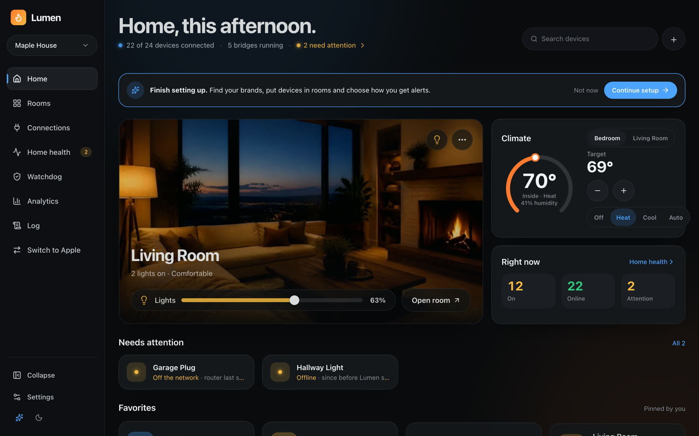
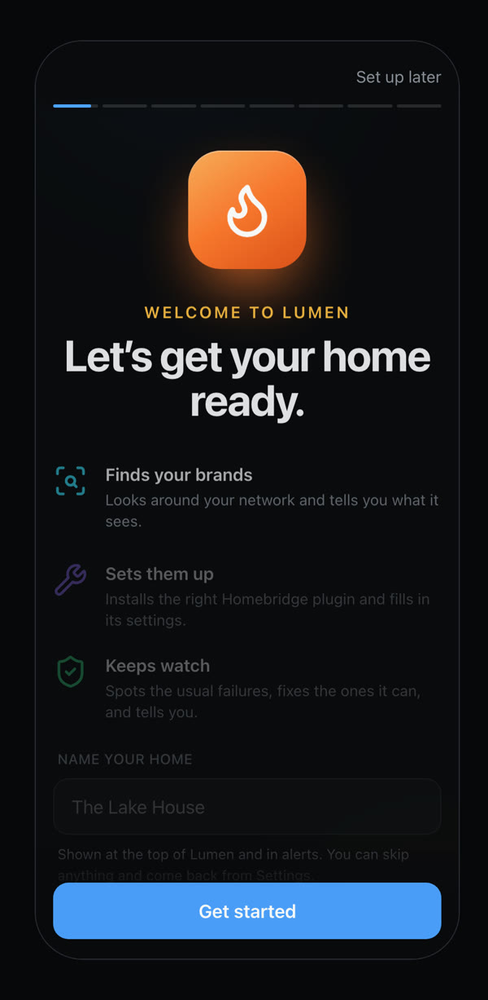
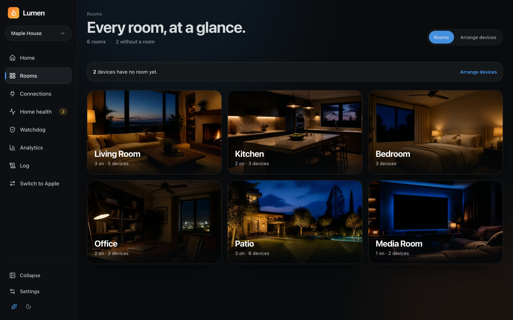
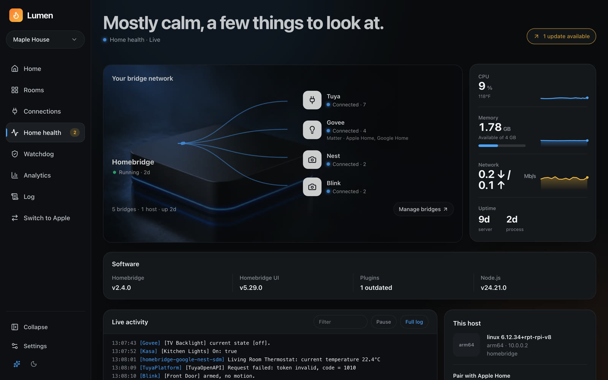

# Lumen for Raspberry Pi

A ready-to-flash Raspberry Pi image with **Homebridge** and **Lumen** already installed. Flash it, plug it in, open a web page, and Lumen walks you through putting your smart-home gear into Apple Home, then keeps an eye on it.

**[Download the latest image →](https://github.com/amar-naga/lumen-pi/releases/latest)**

## What Lumen does

- **Finds your brands.** It scans your network and tells you what it sees: Kasa, Tuya / Smart Life, Nest, Hue, Govee, Blink, Ring, Sonos, Shelly, WiZ, ecobee and more.
- **Sets them up.** It installs the right Homebridge plugin and fills in the settings, with step-by-step instructions where a brand needs a login or a few clicks on its own website (Nest, for example).
- **Keeps watch.** It spots the usual failures (a plug that dropped off Wi-Fi, a plugin that stopped talking to a device, a bridge that crashed), fixes what it can by itself and tells you about the rest.
- **One place for everything.** Rooms, controls, health, a log of what happened, and alerts to your phone.

| Every room at a glance | Home health |
| --- | --- |
|  |  |

*Screenshots use demo data.*

## What you need

- A **Raspberry Pi 3, 4, 5 or Zero 2 W**. A Pi 4 with 2 GB is plenty.
- Its official **power supply**.
- A **microSD card**, 16 GB or larger.
- A computer with an SD card slot or USB card reader.
- An **iPhone** with the Home app, for adding it to Apple Home.
- A network cable to your router is the most reliable connection. Wi-Fi works too.

## Install

1. **Download** `lumen-<version>-pi-64bit.img.xz` from the [latest release](https://github.com/amar-naga/lumen-pi/releases/latest). There is no need to unzip it.
2. Install and open **[Raspberry Pi Imager](https://www.raspberrypi.com/software/)**.
3. Choose your Pi model, then **Choose OS → Use custom** and pick the file you downloaded. Choose your SD card.
4. When Imager offers to **customise settings**, say yes and:
   - set the **hostname** to `homebridge`;
   - set a username and password;
   - add your **Wi-Fi** name and password if the Pi won't be on a network cable.
5. Write the card, put it in the Pi, connect the cable (if using one) and power it on.

No Wi-Fi set and no cable? After a few minutes the Pi starts its own Wi-Fi network called **Homebridge WiFi Setup**. Join it from your phone and pick your home network.

## First visit

1. Give it about **five minutes** on the very first start.
2. On a phone or computer on the same network, open **http://homebridge.local:3010**.
   If that doesn't open, find the Pi's address in your router's device list and open `http://<that address>:3010`.
3. **Choose the household password straight away.** Until you do, anyone on your network could. The same password signs you in to the Homebridge UI (username `admin`).
4. Follow the setup screens:
   - **Add to Apple Home:** scan the code with your iPhone. The Home app says *Uncertified Accessory*; that's normal for Homebridge, tap **Add Anyway**.
   - **Find your brands:** Lumen scans your network and lists what it found, with what to do for each.
   - **Rooms and alerts:** optional, and you can come back to them from Settings.

The Homebridge UI is still there at **http://homebridge.local** for plugin settings, backups, logs and updates.

## Troubleshooting

| Problem | Try this |
| --- | --- |
| `homebridge.local` won't open | Use the Pi's IP address from your router's device list, with `:3010` on the end. Some Android phones and Windows PCs don't resolve `.local` names. |
| Nothing after 10 minutes | Check the Pi's green light is flickering. Re-flash the card and make sure the hostname and Wi-Fi were set in Imager. |
| A brand isn't found by the scan | Pick it from the full list on the Brands step; the scan only sees devices that are switched on and on the same network. |
| Devices show **No Response** in Home | Open Lumen → **Home health**. It shows which plugin or device is the cause and what to do. |
| Forgot the password | Ask the person who sent you the link: there is a reset that keeps your setup. Re-flashing the card also works, but then Apple Home needs adding again. |

## Updates

Updates are new images or plugin files posted on the [releases page](https://github.com/amar-naga/lumen-pi/releases). Homebridge itself and its plugins update from the Homebridge UI as usual.

## About the image

It is the [Homebridge Raspberry Pi image](https://github.com/homebridge/homebridge-raspbian-image) with Lumen added; it is not an official Homebridge image. A one-time service adds Lumen to Homebridge's config on first start. Nothing else is changed, and every Pi gets its own HomeKit identity.

This is a **test build**. If something doesn't work, tell the person who sent you the link, with a screenshot.
